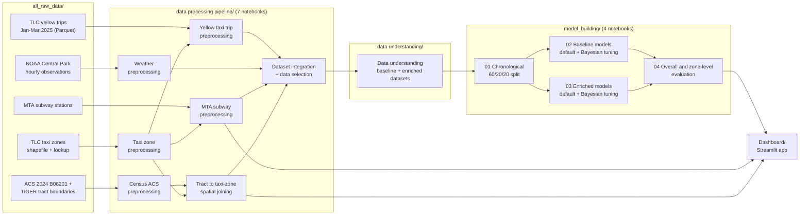
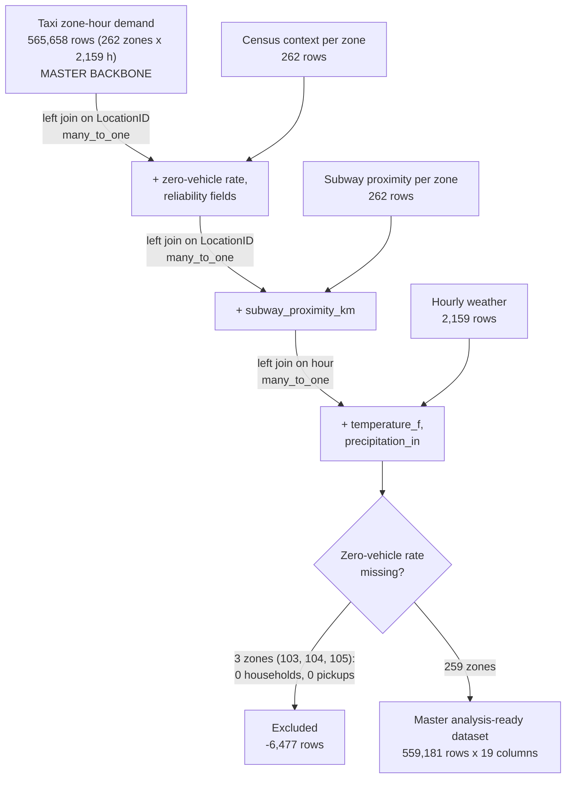
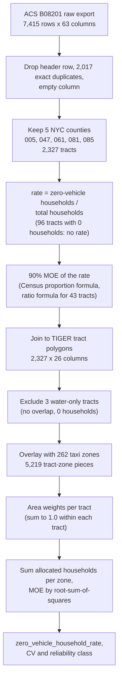
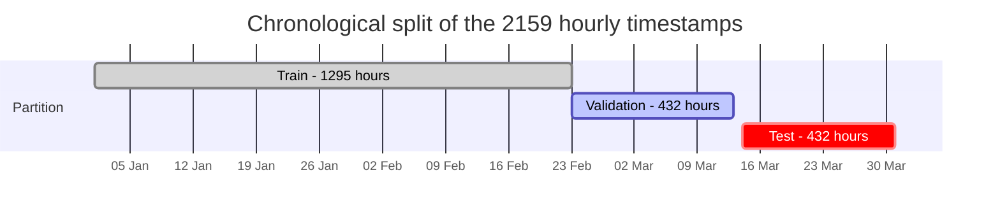
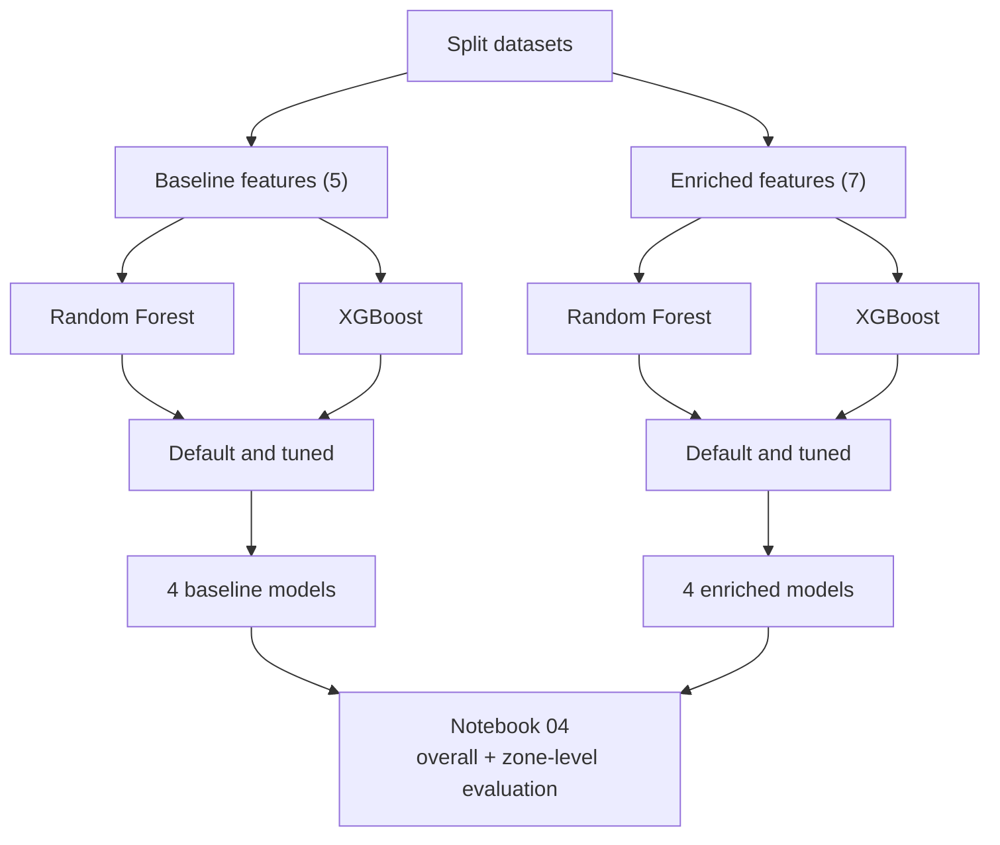
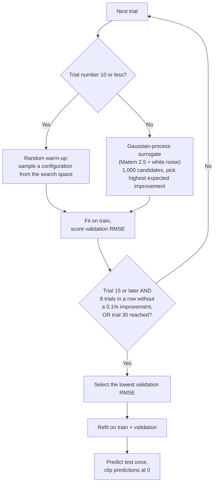
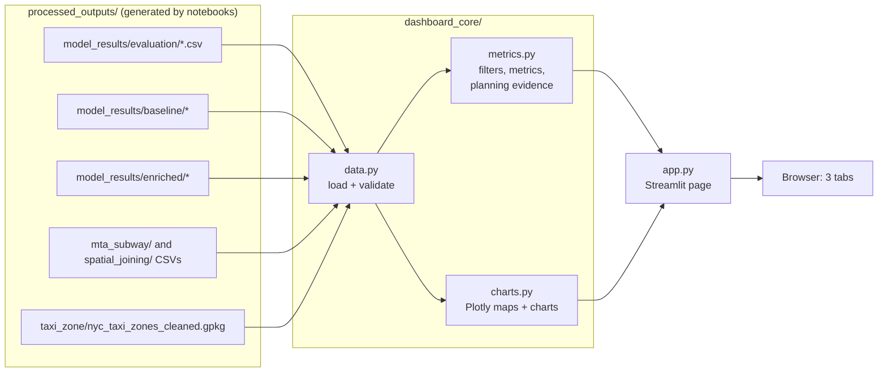
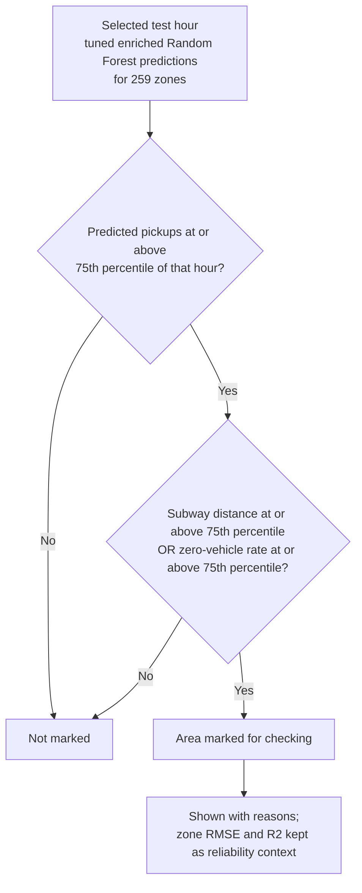

# Evaluating Machine Learning Models for Taxi Demand Prediction in Underserved Urban Zones

My final-year project (BSc, Asia Pacific University). It asks how well **Random Forest** and **XGBoost** predict **hourly yellow-taxi pickups in every NYC taxi zone**, and whether adding two zone-level context features, **distance to the nearest subway station** and the **share of households with no vehicle**, helps most where taxi demand is thinnest (the low-demand outer-borough zones).

The work covers the full path: raw TLC trip records, weather, MTA stations and US Census data are cleaned and merged into one `zone x hour` table for **January to March 2025**, eight models are trained and tuned (baseline and enriched feature sets, default and Bayesian-tuned settings), they are evaluated overall and **zone by zone** on an untouched test period, and the results are explored in a **Streamlit evidence dashboard**.

---

## Table of contents

1. [What it does](#what-it-does)
2. [End-to-end pipeline](#end-to-end-pipeline)
3. [Data sources and how they are joined](#data-sources-and-how-they-are-joined)
4. [Data preparation in detail](#data-preparation-in-detail)
5. [Modelling design](#modelling-design)
6. [Project structure](#project-structure)
7. [Setup and run](#setup-and-run)
8. [Code walkthrough](#code-walkthrough)
9. [Results](#results)
10. [The dashboard](#the-dashboard)
11. [Troubleshooting](#troubleshooting)
12. [Limitations and next steps](#limitations-and-next-steps)

---

## What it does

- Builds a **master dataset of 559,181 rows**: 259 taxi zones x 2,159 hourly timestamps (1 Jan to 31 Mar 2025, New York local time), with the pickup count as the target.
- Trains **Random Forest** and **XGBoost** regressors on two feature sets and compares them under identical conditions:
  - **Baseline (5 features):** `hour`, `day_of_week`, `month`, `temperature_f`, `precipitation_in`
  - **Enriched (7 features):** baseline plus `subway_proximity_km` and `zero_vehicle_household_rate`
- Tunes each model with a self-written **Gaussian-process Bayesian optimisation** (expected improvement) driven by validation RMSE only.
- Evaluates on a chronological test window (14 to 31 March 2025, 432 hours) **overall, per zone (259 zones), and for the 49 low-demand outer-borough zones**.
- Presents everything in a three-tab **Streamlit dashboard** with maps, trend charts and a transparent, rule-based "areas to check" screen.

The three research objectives (as stated in the dashboard documentation):

1. Zone-level Random Forest and XGBoost performance.
2. Contextual enrichment in the 49 low-demand outer-borough zones.
3. Historical predicted-demand heatmaps and deployment-consideration evidence that combine final-model demand with accessibility context.

> The dashboard is **historical decision support**. It does not provide live prediction, calibrated confidence, congestion estimates or automated fleet-deployment recommendations.

| Technology | Role |
|---|---|
| Python 3.13 (notebook kernels) | Language for all notebooks |
| pandas, NumPy, SciPy | Cleaning, joins, statistics, Spearman / Pearson tests |
| GeoPandas, Shapely, pyproj | Taxi-zone polygons, Census-tract overlay, nearest-station search (EPSG:2263) |
| scikit-learn | `RandomForestRegressor`, Gaussian-process surrogate, permutation importance, metrics |
| XGBoost 3.1.1 | `XGBRegressor` (`tree_method="hist"`) |
| joblib | Saving the fitted models |
| Matplotlib, seaborn | Notebook figures |
| Jupyter notebooks | The whole pipeline (12 notebooks) |
| Streamlit, Plotly | Interactive dashboard with choropleth maps (CARTO dark basemap) |
| Parquet, CSV, GeoPackage, Shapefile | Data formats |

---

## End-to-end pipeline



The notebooks are numbered in the order they must be run (see [Setup and run](#setup-and-run)). Each stage writes its outputs to `processed_outputs/` and the next stage reads them from there.

---

## Data sources and how they are joined

| Source (in `all_raw_data/`) | What it contains | Used for |
|---|---|---|
| `tlc_trips/yellow_tripdata_2025-01..03.parquet` | 11,198,026 raw yellow-taxi trips (3,475,226 + 3,577,543 + 4,145,257), 20 columns each | The target: pickups per zone per hour |
| `taxi_zones/` (shapefile + `taxi_zone_lookup.csv`) | 263 TLC zone polygons (EPSG:2263) and a 265-row lookup with `service_zone` | The spatial backbone and `LocationID` key |
| `noaa_weather/nyc_weather_hourly.csv` | 7,722 raw observation rows, 91 columns, one station (NY City Central Park, `72505394728`) | `temperature_f`, `precipitation_in` |
| `mta_subway/MTA_Subway_Stations.csv` | 496 station records, 19 columns | `subway_proximity_km` |
| `census_acs/vehicle_availability/` (ACS 2024 5-year, table B08201) + `tract_boundaries/` (TIGER/Line `tl_2024_36_tract`) + `Reference/` (county FIPS) | Households by vehicles available per census tract, with margins of error | `zero_vehicle_household_rate` |



---

## Data preparation in detail

### Yellow taxi trips to zone-hour demand

`NYC_Yellow_Taxi_Trip_Preprocessing_Final.ipynb` turns 11.2 million trips into one count per zone per hour. Every removal is applied in order and its count is printed in the notebook:

| Step | Rule | Records removed |
|---|---|---:|
| 1 | Pickup outside 1 Jan to 31 Mar 2025 (New York time) | 25 |
| 2 | Trip duration under 10 s (negative, zero and very short) | 74,634 |
| 3 | Pickup location not in the 262-zone reference | 25,870 |
| 4 | Drop-off location not in the 262-zone reference | 71,909 |
| 5 | Explicit zero or negative passenger count (missing counts are kept) | 66,603 |
| 6 | Missing, zero or negative `fare_amount` | 529,258 |
| 7 | Missing, zero or negative `trip_distance` | 208,929 |
| 8 | Missing or non-positive `total_amount` | 69 |
| 9 | Implied average speed above 60 mph | 2,108 |
| | **Valid trips kept** | **10,218,621** |

Valid trips are floored to the hour, grouped by `(LocationID, pickup_hour)` (303,285 observed combinations) and then **zero-padded**: every zone gets a row for every hour, so 262,373 unobserved combinations become explicit zeros, giving 262 x 2,159 = 565,658 rows. `hour`, `day_of_week` (0 = Monday) and `month` are derived from the local timestamp.

### Taxi zones

`NYC_Taxi_Zone_Preprocessing.ipynb` checks the 263 TLC polygons (unique IDs, no empty or invalid geometry), adds `service_zone` from the lookup, and **drops LocationID 1 (Newark Airport, EWR)** because the study is limited to the five boroughs. Result: 262 polygons (Bronx 43, Brooklyn 61, Manhattan 69, Queens 69, Staten Island 20).

### Weather

`Weather_Preprocessing.ipynb` converts NOAA timestamps from UTC to New York time and keeps routine hourly (FM-15) and special (FM-16) reports. One value per hour is chosen by quality code, report type and closeness to minute 51.

- Temperature is decoded from the encoded `TMP` field and converted to Fahrenheit. 2,123 hours have a direct reading; the remaining **37 hours are time-interpolated** and flagged.
- Precipitation is decoded from the `AA1`-`AA3` one-hour accumulations and converted to inches. Hours still missing (247) are resolved with the NOAA daily totals: 243 become confirmed dry (zero) hours and 4 receive an allocated share of the daily residual.
- The 2,160-row wall-clock timeline contains the non-existent 02:00 hour of 9 March 2025 (daylight-saving change). It is flagged `dst_nonexistent_hour` and removed during integration, leaving 2,159 hours that match the taxi data exactly.

### Subway proximity

`MTA_Subway_Station_Preprocessing.ipynb` reduces 496 station rows to **493 distinct physical locations** (three repeated multi-route rows removed; all 21 Staten Island Railway stops kept). Each zone's polygon centroid is matched to the nearest station with `geopandas.sjoin_nearest` in EPSG:2263 and the distance is converted to kilometres. This is a **straight-line** distance, not walking time.

| Borough | Zones | Mean km | Median km | Max km |
|---|---:|---:|---:|---:|
| Manhattan | 69 | 0.412 | 0.285 | 2.997 |
| Brooklyn | 61 | 0.678 | 0.463 | 4.427 |
| Bronx | 43 | 0.803 | 0.556 | 3.908 |
| Queens | 69 | 1.963 | 1.213 | 7.178 |
| Staten Island | 20 | 2.232 | 1.493 | 7.571 |

### Census: zero-vehicle households

Two notebooks turn tract-level ACS data into one value per taxi zone.



- **Allocation assumption:** households are spread uniformly over each tract's area. The notebook checks that total and zero-vehicle household counts are preserved exactly after allocation.
- **Reliability class** (from the coefficient of variation of the rate): high (CV up to 12%), moderate (up to 40%), low (above 40%). Across the 259 modelled zones: **208 high, 38 moderate, 13 low**. These fields are kept for quality interpretation and are **not** model predictors.
- Zones 103, 104 and 105 (Governor's Island / Ellis Island / Liberty Island) have zero estimated households and zero Q1 pickups, so they are excluded rather than imputed.

### Integration

`NYC_Dataset_Integration_WITH_DATA_SELECTION.ipynb` joins the four processed tables onto the taxi backbone (diagram above), validates row counts and total pickups (10,218,621 preserved), removes the three non-analysable zones, and keeps 19 columns. `NYC_Yellow_Taxi_Data_Understanding_UPDATED.ipynb` then profiles the master table and writes the two model-ready datasets (baseline: 10 columns, enriched: 12 columns, both 559,181 rows).

### What the data looks like

| Finding (from the Data Understanding notebook) | Value |
|---|---|
| Mean / median pickups per zone-hour | 18.27 / 1 |
| Standard deviation, 99th percentile, maximum | 54.88, 279, 988 |
| Zone-hours with zero pickups | 255,896 (45.76%) |
| Skewness of the target | 4.87 |
| Share of pickups: Manhattan / Queens / Brooklyn / Bronx / Staten Island | 88.62% / 8.28% / 2.48% / 0.61% / 0.01% |
| Busiest hour of day (mean) | 18:00 (31.24 pickups per zone-hour) |
| Quietest hour of day (mean) | 04:00 (2.90) |
| Busiest weekday-hour | Saturday 19:00 (35.73) |
| Spearman: subway distance vs zone demand | -0.555 |
| Spearman: zero-vehicle rate vs zone demand | +0.684 |
| Pearson: temperature / precipitation vs citywide hourly pickups | 0.194 / 0.098 |

Demand is extremely concentrated and skewed, which is why the project reports metrics **per zone** and not only citywide.

---

## Modelling design

### Chronological split

The 2,159 unique hours are split **in time order** (60/20/20), and a whole hour belongs to exactly one partition. All 259 zones appear in every partition, so `LocationID` repeats through time and is kept **only as evaluation metadata, never as a predictor**.



| Partition | Hours | Rows | Share | Start | End |
|---|---:|---:|---:|---|---|
| Train | 1,295 | 335,405 | 59.98% | 2025-01-01 00:00 | 2025-02-23 22:00 |
| Validation | 432 | 111,888 | 20.01% | 2025-02-23 23:00 | 2025-03-13 23:00 |
| Test | 432 | 111,888 | 20.01% | 2025-03-14 00:00 | 2025-03-31 23:00 |

### Eight models



### Bayesian tuning loop

Both algorithms use the **same** procedure so the comparison stays controlled (random seed 42, selection metric = validation RMSE; the test set is not touched).



Search spaces:

| Algorithm | Hyperparameter | Range | Scale |
|---|---|---|---|
| Random Forest | `n_estimators` | 80 to 300 | integer |
| | `max_depth` | 4 to 18 | integer |
| | `min_samples_split` | 2 to 30 | integer |
| | `min_samples_leaf` | 1 to 1200 | log integer |
| | `max_features` | 0.50 to 1.00 | float |
| XGBoost | `n_estimators` | 80 to 350 | integer |
| | `learning_rate` | 0.01 to 0.20 | log float |
| | `max_depth` | 2 to 8 | integer |
| | `min_child_weight` | 1 to 500 | log float |
| | `subsample` | 0.60 to 1.00 | float |
| | `colsample_bytree` | 0.60 to 1.00 | float |

Metrics are **RMSE** (primary), **MAE** and **R²**. Accuracy and MAPE are deliberately not used because the target has many zeros.

---

## Project structure

```
Evaluating-Machine-Learning-Models-for-Taxi-Demand-Prediction-in-Underserved-Urban-Zones/
├── all_raw_data/                       # Source data (committed)
│   ├── tlc_trips/                      #   yellow_tripdata_2025-01/02/03.parquet
│   ├── taxi_zones/                     #   taxi_zones.shp (+ .dbf/.shx/.prj/.cpg), taxi_zone_lookup.csv
│   ├── noaa_weather/                   #   nyc_weather_hourly.csv
│   ├── mta_subway/                     #   MTA_Subway_Stations.csv
│   └── census_acs/                     #   vehicle_availability/, tract_boundaries/, Reference/, metadata/
│
├── data processing pipeline/           # Stage 1: cleaning and integration notebooks
│   ├── NYC_Taxi_Zone_Preprocessing.ipynb
│   ├── NYC_Yellow_Taxi_Trip_Preprocessing_Final.ipynb
│   ├── Weather_Preprocessing.ipynb
│   ├── MTA_Subway_Station_Preprocessing.ipynb
│   ├── Census_Tract_ACS_B08201_Preprocessing.ipynb
│   ├── Census_Tract_to_Taxi_Zone_Spatial_Joining.ipynb
│   └── NYC_Dataset_Integration_WITH_DATA_SELECTION.ipynb
│
├── data understanding/                 # Stage 2: EDA, low-demand definition, model datasets
│   └── NYC_Yellow_Taxi_Data_Understanding_UPDATED.ipynb
│
├── model_building/                     # Stage 3: split, train, tune, evaluate
│   ├── 01_Data_Splitting_and_Model_Preparation.ipynb
│   ├── 02_Baseline_Model_Default_and_Bayesian_Tuning.ipynb
│   ├── 03_Enriched_Model_Default_and_Bayesian_Tuning.ipynb
│   └── 04_Overall_and_Zone_Level_Model_Evaluation.ipynb
│
├── processed_outputs/                  # Outputs of stage 1 (committed)
│   ├── taxi_zone/                      #   nyc_taxi_zones_cleaned.csv / .gpkg
│   ├── yellow_taxi/                    #   nyc_yellow_taxi_zone_hour_demand_2025_q1.csv
│   ├── weather/                        #   nyc_central_park_weather_hourly_2025_q1.csv
│   ├── mta_subway/                     #   nyc_taxi_zone_subway_proximity.csv
│   ├── census_tract/                   #   nyc_zero_vehicle_households_by_tract.csv / .gpkg
│   ├── spatial_joining/                #   nyc_taxi_zones_with_zero_vehicle_context.csv / .gpkg
│   ├── model_datasets/                 #   GENERATED by stages 2-3 (git-ignored, not in the repo)
│   └── model_results/                  #   GENERATED by notebooks 02-04 (git-ignored, not in the repo)
│                                       #     sub-folders: baseline/, enriched/, evaluation/
│
├── Dashboard/                          # Streamlit evidence dashboard
│   ├── app.py                          #   Page layout: 3 objective tabs
│   ├── dashboard_core/
│   │   ├── data.py                     #   Loads and validates all CSV / GeoPackage inputs
│   │   ├── metrics.py                  #   Filters, metric recalculation, planning-evidence rules
│   │   └── charts.py                   #   Plotly maps and charts, shared dark theme
│   ├── assets/styles.css               #   Custom dark styling
│   ├── .streamlit/config.toml          #   Theme and server settings
│   ├── requirements.txt
│   └── README.md                       #   Dashboard-specific notes
│
└── .gitignore
```

> `processed_outputs/model_datasets/` (large CSVs) and `processed_outputs/model_results/` (trained `.joblib` models, predictions, metrics) are listed in `.gitignore`, so they are **not in a fresh clone**. You regenerate them by running the notebooks (see below). The dashboard cannot start until `model_results/` exists.

---

## Setup and run

### 1. Prerequisites

- Python 3.13 (the notebook kernels recorded Python 3.13.7; pandas 2.3.3, NumPy 2.2.6 and XGBoost 3.1.1 appear in the saved outputs)
- Jupyter (JupyterLab or VS Code)
- Enough free disk space for the committed data (about 240 MB without dependencies), plus the generated model datasets and `.joblib` models

### 2. Install

The repository has a `requirements.txt` for the dashboard only. For the notebooks, these packages follow from the imports (there is no pinned list):

```bash
pip install pandas numpy scipy scikit-learn xgboost matplotlib seaborn joblib \
            geopandas shapely pyproj pyogrio pyarrow openpyxl jupyterlab
```

For the dashboard (`Dashboard/requirements.txt`):

```bash
cd Dashboard
python -m venv .venv
# Windows PowerShell:  .\.venv\Scripts\Activate.ps1
# macOS / Linux:       source .venv/bin/activate
python -m pip install -r requirements.txt
```

It pins `streamlit>=1.42,<2`, `pandas>=2.2,<3`, `plotly>=5.24,<7`, `geopandas>=1.0,<2`, `pyogrio>=0.10,<1`, `shapely>=2.0,<3`. The committed dashboard environment used Streamlit 1.62.0, Plotly 6.9.0, GeoPandas 1.1.4, pandas 2.3.3, pyogrio 0.13.0 and Shapely 2.1.2.

### 3. Point the notebooks at your folder

The notebooks were written on Windows with an absolute project path near the top of each one. Change it to where you cloned the repository:

| Notebooks | What to change |
|---|---|
| `model_building/01` to `04` | Set the environment variable `NYC_TAXI_PROCESSED_OUTPUTS` to the full path of `processed_outputs/` (the notebooks fall back to the original Windows path if it is not set) |
| All notebooks in `data processing pipeline/` and `data understanding/` | Edit the `PROJECT_ROOT` / `PROCESSED_DIR` / `MODEL_DATA_DIR` constant in the first code cells |
| `Census_Tract_ACS_B08201_Preprocessing.ipynb` | It looks for inputs under `data/census_acs/...`; this repository stores them under `all_raw_data/census_acs/...`, so adjust `VEHICLE_DIR`, `REFERENCE_DIR` and `TRACT_BOUNDARY_DIR` |

### 4. Run the notebooks in order

The outputs of steps 1 to 6 are already committed in `processed_outputs/`, so you can **start at step 7** unless you want to reproduce the cleaning.

| Step | Notebook | Reads | Writes |
|---|---|---|---|
| 1 | `NYC_Taxi_Zone_Preprocessing` | `all_raw_data/taxi_zones` | `processed_outputs/taxi_zone/` |
| 2 | `NYC_Yellow_Taxi_Trip_Preprocessing_Final` | TLC Parquet files, cleaned zones | `processed_outputs/yellow_taxi/` |
| 3 | `Weather_Preprocessing` | `all_raw_data/noaa_weather` | `processed_outputs/weather/` |
| 4 | `MTA_Subway_Station_Preprocessing` | MTA stations, cleaned zones | `processed_outputs/mta_subway/` |
| 5 | `Census_Tract_ACS_B08201_Preprocessing` | ACS B08201, TIGER tracts, FIPS reference | `processed_outputs/census_tract/` |
| 6 | `Census_Tract_to_Taxi_Zone_Spatial_Joining` | tract and zone GeoPackages | `processed_outputs/spatial_joining/` |
| 7 | `NYC_Dataset_Integration_WITH_DATA_SELECTION` | outputs of steps 2, 3, 4, 6 | `model_datasets/nyc_yellow_taxi_master_analysis_ready_2025_q1.csv` |
| 8 | `NYC_Yellow_Taxi_Data_Understanding_UPDATED` | master dataset | baseline and enriched model datasets, zone evaluation reference |
| 9 | `01_Data_Splitting_and_Model_Preparation` | baseline and enriched model datasets | six split CSVs (train / validation / test x 2) |
| 10 | `02_Baseline_Model_Default_and_Bayesian_Tuning` | baseline splits | `model_results/baseline/` (15 files incl. 4 `.joblib` models) |
| 11 | `03_Enriched_Model_Default_and_Bayesian_Tuning` | enriched splits | `model_results/enriched/` (15 files incl. 4 `.joblib` models) |
| 12 | `04_Overall_and_Zone_Level_Model_Evaluation` | test predictions from 10 and 11, baseline train split | `model_results/evaluation/` (12 CSV tables) |

Tuning is the slow part (each trial fits a full model on 335,405 rows; the saved outputs show 22 to 29 trials per algorithm per feature set, with single Random Forest fits taking tens of seconds).

### 5. Start the dashboard

```bash
cd Dashboard
streamlit run app.py
```

Keep the `Dashboard/` folder directly inside the project root: the app derives the root as the parent of `Dashboard/` and reads `processed_outputs/` from there. To use another location, set `FYP_PROJECT_ROOT` first:

```bash
# Windows PowerShell
$env:FYP_PROJECT_ROOT = "C:\path\to\project"
# macOS / Linux
export FYP_PROJECT_ROOT=/path/to/project
```

---

## Code walkthrough

### Chronological split (`model_building/01`)

```python
unique_hours = np.array(sorted(baseline["pickup_hour"].unique()))
n_hours = len(unique_hours)
n_train_hours = int(np.floor(n_hours * 0.60))
n_validation_hours = (n_hours - n_train_hours) // 2

train_hours = unique_hours[:n_train_hours]
validation_hours = unique_hours[n_train_hours:n_train_hours + n_validation_hours]
test_hours = unique_hours[n_train_hours + n_validation_hours:]
```

Whole timestamps go to one partition only, so no hour is shared between development and testing data.

### Feature sets (`model_building/01`)

```python
BASELINE_FEATURES = ["hour", "day_of_week", "month", "temperature_f", "precipitation_in"]
CONTEXTUAL_FEATURES = ["subway_proximity_km", "zero_vehicle_household_rate"]
ENRICHED_FEATURES = BASELINE_FEATURES + CONTEXTUAL_FEATURES
METADATA_COLUMNS = ["LocationID", "borough", "zone", "pickup_hour"]   # never fed to a model
```

### Model factory (`model_building/02`, `03`)

```python
def build_model(algorithm, parameters=None):
    parameters = {} if parameters is None else dict(parameters)
    if algorithm == "Random Forest":
        return RandomForestRegressor(random_state=RANDOM_STATE, n_jobs=-1, **parameters)
    return XGBRegressor(objective="reg:squarederror", tree_method="hist",
                        random_state=RANDOM_STATE, n_jobs=-1, verbosity=0, **parameters)
```

### Bayesian proposal step (`model_building/02`, `03`)

```python
kernel = ConstantKernel(1.0) * Matern(length_scale=0.5, nu=2.5) + WhiteKernel(1e-5)
surrogate = GaussianProcessRegressor(kernel=kernel, normalize_y=True,
                                     random_state=RANDOM_STATE, n_restarts_optimizer=1)
surrogate.fit(X_history, y_history)
mean, std = surrogate.predict(X_candidates, return_std=True)

improvement = y_history.min() - mean - 0.01
z_score = np.divide(improvement, std, out=np.zeros_like(improvement), where=std > 0)
expected_improvement = improvement * norm.cdf(z_score) + std * norm.pdf(z_score)
```

The surrogate is fitted on the (encoded) trial history; the candidate with the highest expected improvement is the next configuration to try.

### Final refit and test prediction (`model_building/02`, `03`)

```python
model = build_model(algorithm, parameters)
model.fit(X_train_validation, y_train_validation)          # train + validation combined
predictions = np.clip(model.predict(X_test), 0, None)      # no negative pickup counts
```

### Zone-level metrics (`model_building/04`)

```python
def safe_r2(actual, predicted):
    # R-squared is undefined when actual demand has no variation.
    if np.sum((actual - actual.mean()) ** 2) == 0:
        return np.nan
    return float(r2_score(actual, predicted))
```

Each zone is scored on its own 432 test hours. Zone RMSE is also standardised within a model (z-score), and a zone is flagged **unusually high error** when its z-score is at least 2.

### Low-demand outer-borough definition (`model_building/04`)

```python
OUTER_BOROUGHS = ["Bronx", "Brooklyn", "Queens", "Staten Island"]
LOW_DEMAND_QUANTILE = 0.25
# mean hourly TRAINING demand per zone, bottom quartile among outer-borough zones
low_demand_threshold = outer_zone_demand["Training_mean_hourly_demand"].quantile(LOW_DEMAND_QUANTILE)
```

Defined from the training partition only, so the test period stays independent: 193 outer-borough zones, threshold 0.2093 pickups per zone-hour, **49 low-demand zones**.

### Dashboard "area to check" rule (`Dashboard/dashboard_core/metrics.py`)

```python
evidence["Limited subway access"] = evidence["subway_proximity_km"].ge(thresholds.subway_q75_km)
evidence["High zero-vehicle rate"] = evidence["zero_vehicle_household_rate"].ge(thresholds.zero_vehicle_q75)
evidence["Context concern"] = evidence["Limited subway access"] | evidence["High zero-vehicle rate"]

threshold = float(evidence["Predicted pickups"].quantile(0.75))          # per selected hour
evidence["High predicted demand"] = evidence["Predicted pickups"].ge(threshold)
evidence["Deployment consideration"] = evidence["High predicted demand"] & evidence["Context concern"]
```

---

## Results

All numbers below are copied from the saved notebook outputs. Test = 14 to 31 March 2025, 111,888 zone-hour rows.

### Overall test performance (all 259 zones pooled)

| Feature set | Algorithm | Config | RMSE | MAE | R² |
|---|---|---|---:|---:|---:|
| Baseline | Random Forest | Default | 54.6348 | 28.2677 | 0.0345 |
| Baseline | Random Forest | Tuned | 54.6256 | 28.2422 | 0.0349 |
| Baseline | XGBoost | Default | 54.6276 | 28.3391 | 0.0348 |
| Baseline | XGBoost | Tuned | 54.6447 | 28.3933 | 0.0342 |
| Enriched | Random Forest | Default | **11.5477** | **3.8465** | **0.9569** |
| Enriched | Random Forest | Tuned | 11.9725 | 3.9007 | 0.9536 |
| Enriched | XGBoost | Default | 13.3107 | 5.2677 | 0.9427 |
| Enriched | XGBoost | Tuned | 12.0126 | 4.4925 | 0.9533 |

- Adding the two contextual features cuts pooled test RMSE by roughly **76% to 79%** (for example Random Forest default 54.63 to 11.55, a 78.9% reduction) and raises R² from about 0.03 to about 0.94-0.96.
- The five baseline features alone explain very little (R² around 0.03). Among them, permutation importance is dominated by `hour` and `day_of_week`; weather and `month` contribute almost nothing.

### Did tuning help?

| Feature set | Algorithm | Default validation RMSE | Best validation RMSE | Best trial / stopped at | Effect on **test** RMSE |
|---|---|---:|---:|---|---:|
| Baseline | Random Forest | 56.7443 | 56.6280 | 17 / 22 | 0.02% lower |
| Baseline | XGBoost | 56.7824 | 56.6655 | 19 / 22 | 0.03% **higher** |
| Enriched | Random Forest | 15.9697 | 14.0640 | 23 / 29 | 3.68% **higher** |
| Enriched | XGBoost | 16.8063 | 15.1656 | 13 / 22 | 9.75% lower |

Tuning improved **validation** RMSE (by 0.2% for baseline, 9.8% to 11.9% for enriched), but on the untouched test period the gains were negligible or reversed, except for enriched XGBoost. The best enriched default Random Forest is therefore better on test than its tuned version.

Selected hyperparameters:

| Model | Selected values |
|---|---|
| Baseline RF | `n_estimators` 171, `max_depth` 9, `min_samples_split` 5, `min_samples_leaf` 955, `max_features` 0.922 |
| Baseline XGB | `n_estimators` 334, `learning_rate` 0.0210, `max_depth` 3, `min_child_weight` 7.25, `subsample` 0.604, `colsample_bytree` 0.927 |
| Enriched RF | `n_estimators` 272, `max_depth` 18, `min_samples_split` 5, `min_samples_leaf` 10, `max_features` 0.862 |
| Enriched XGB | `n_estimators` 315, `learning_rate` 0.1710, `max_depth` 8, `min_child_weight` 31.48, `subsample` 0.797, `colsample_bytree` 0.995 |

### Permutation importance (tuned models, increase in test RMSE)

| Feature | Baseline RF | Baseline XGB | Enriched RF | Enriched XGB |
|---|---:|---:|---:|---:|
| `zero_vehicle_household_rate` | - | - | 44.89 | 33.36 |
| `subway_proximity_km` | - | - | 43.15 | 45.97 |
| `hour` | 1.90 | 1.75 | 35.54 | 36.01 |
| `day_of_week` | 0.50 | 0.33 | 16.28 | 16.49 |
| `temperature_f` | 0.001 | 0.008 | 0.028 | 0.101 |
| `precipitation_in` | 0.001 | 0.015 | 0.028 | 0.306 |
| `month` | 0.000 | 0.000 | 0.000 | 0.000 |

`month` is exactly zero because the test window lies entirely in March, so there is nothing to permute.

### Zone-level performance (259 zones, 432 test hours each)

| Model | Median zone RMSE | Zones with negative R² | Zones flagged high error |
|---|---:|---:|---:|
| Baseline RF default | 21.17 | 242 | 17 |
| Baseline RF tuned | 21.20 | 242 | 17 |
| Baseline XGB default | 21.33 | 242 | 17 |
| Baseline XGB tuned | 20.91 | 243 | 17 |
| Enriched RF default | 1.54 | 76 | 13 |
| Enriched RF tuned | 1.52 | 28 | 15 |
| Enriched XGB default | 2.69 | 159 | 14 |
| Enriched XGB tuned | 2.36 | 141 | 14 |

Six zones have constant actual demand in the test window, so their R² is left **undefined** (not set to zero). For the same algorithm and configuration, enrichment lowered zone RMSE in **259 of 259 zones** (258 of 259 for enriched XGBoost default), with a median RMSE reduction of 86.8% to 92.5%.

### Low-demand outer-borough zones (49 zones, 21,168 test observations)

| Feature set | Algorithm | Config | Pooled RMSE | Pooled MAE | Pooled R² |
|---|---|---|---:|---:|---:|
| Baseline | Random Forest | Default | 21.8040 | 19.1251 | -3673.61 |
| Baseline | Random Forest | Tuned | 21.8315 | 19.0940 | -3682.92 |
| Baseline | XGBoost | Default | 21.9651 | 19.2211 | -3728.12 |
| Baseline | XGBoost | Tuned | 21.5524 | 19.3223 | -3589.32 |
| Enriched | Random Forest | Default | 0.3632 | 0.1606 | -0.0198 |
| Enriched | Random Forest | Tuned | **0.3403** | **0.1567** | **0.1052** |
| Enriched | XGBoost | Default | 1.3334 | 0.7495 | -12.7428 |
| Enriched | XGBoost | Tuned | 1.1096 | 0.5279 | -8.5167 |

All 49 low-demand zones had lower RMSE after enrichment for every matched model pair. The baseline models are far off in these zones (pooled RMSE about 21.6 to 22.0 pickups per zone-hour, although these zones were selected for having a training-period mean of at most 0.21 pickups per hour), which is what drives the extreme negative R². Even after enrichment, most low-demand zones still have a negative zone R² (for example 19 of 49 for the tuned Random Forest, 42 of 49 for tuned XGBoost); the model's absolute errors are small but the series are nearly flat.

### How to read these results

- **The big jump from baseline to enriched needs care.** The two contextual features are constants within a zone (the Data Understanding notebook confirms one value per zone, 259 distinct values for 259 zones). Because `LocationID` is withheld, these two columns can also let a tree model tell zones apart and learn each zone's typical demand level. Permutation importance shows the model relies heavily on them, but, as the dashboard itself warns, it does not show that subway distance or vehicle ownership *cause* the improvement. Treat the result as "context features make the model far better at zone-specific demand levels", not as proof of an accessibility effect.
- **One quarter only.** Everything is Q1 2025 (winter to early spring); the test set is 18 days in March.
- **Pooled metrics are dominated by Manhattan** (88.6% of pickups), which is why the zone-level view matters.

---

## The dashboard

`Dashboard/` is a local Streamlit app (dark theme, wide layout) with three tabs, one per research objective.



| Tab | What you can do |
|---|---|
| **Objective 1: Zone performance** | Pick feature set, algorithm, configuration, boroughs and a focus zone. See filtered RMSE / R², median zone RMSE, negative-R² and high-error zone counts, a zone map (RMSE or R²), actual vs predicted trend, a baseline-vs-enriched improvement map and scatter, the overall 8-model comparison charts and a sortable zone table |
| **Objective 2: Contextual enrichment** | The 49 low-demand zones: pooled RMSE before and after enrichment, zones improved, improvement map and scatter, permutation importance (tuned models only, because default-model importance was never saved), and an explanation of why R² is unstable in sparse zones |
| **Objective 3: Planning evidence** | Choose a date (14 to 31 March 2025) and hour; map predicted demand, actual demand, subway distance or zero-vehicle rate; see KPIs, an aggregated or per-zone trend with the selected hour marked, and a table of "areas to check" with plain-language reasons |

### How an area is marked for checking



The thresholds are dashboard comparison limits across the 259 evaluated zones, **not official NYC service rules**. The flag prompts human investigation and is not evidence that a community lacks taxi service. The app also does not measure current taxi supply, waiting times or unmet demand.

### Built-in safeguards

`dashboard_core/data.py` refuses to render if the sources do not match the approved counts: **259** evaluated zones, **432** test hours, **111,888** test prediction rows, **49** low-demand zones and **262** map geometries. The 3 zones without model rows (LocationIDs 103, 104, 105) are listed in a banner and excluded from analytical maps.

---

## Troubleshooting

| Problem | What to check |
|---|---|
| Dashboard shows "The dashboard could not load its validated source files" | `processed_outputs/model_results/` is not in the repository (git-ignored). Run notebooks 02, 03 and 04 first. The error text lists the missing path. If the project folder is elsewhere, set `FYP_PROJECT_ROOT` |
| `Dashboard source validation failed: ... expected 259 ...` | The result files do not come from the full pipeline run (different zone count, test window or low-demand definition). Re-run notebooks 01 to 04 in order |
| `FileNotFoundError` for `model_datasets/...` in notebook 01 | Run `NYC_Yellow_Taxi_Data_Understanding_UPDATED.ipynb` first (it writes the baseline and enriched model datasets), which in turn needs the integration notebook's master file |
| Notebook cannot find files, or writes to an unexpected location | The absolute Windows path in the first cells still points to the original machine. Set `NYC_TAXI_PROCESSED_OUTPUTS` (notebooks 01-04) or edit the path constants (other notebooks) |
| Integration notebook fails parsing `pickup_hour` | It parses the committed demand CSV with the format `%d/%m/%Y %H:%M` (values such as `1/1/2025 0:00`). The trip-preprocessing notebook exports `%Y-%m-%d %H:%M:%S%z` instead. If you regenerate that CSV, change the `pd.to_datetime(..., format=...)` call to match |
| Census preprocessing notebook: "None of the candidate paths exist" | It expects `data/census_acs/...`; the repository uses `all_raw_data/census_acs/...`. Adjust `VEHICLE_DIR`, `REFERENCE_DIR`, `TRACT_BOUNDARY_DIR` |
| `Unable to create process` when activating a copied `.venv` | Virtual environments are not portable between machines. Delete it and create a new one with `python -m venv .venv` |
| GeoPandas / pyogrio will not install | Install into a fresh virtual environment after `python -m pip install --upgrade pip`. The dashboard was run with GeoPandas 1.1.4 and pyogrio 0.13.0 |
| Tuning notebooks take very long | Each trial is a full model fit on 335,405 rows. Lower `maximum_trials` in `run_bayesian_search` for a quicker (less thorough) run |
| Slightly different numbers after re-running | Seeds are fixed (`RANDOM_STATE = 42`), but different library versions can change tree-model results. The figures in this README come from the saved notebook outputs |

---

## Limitations and next steps

- **Single quarter, single mode.** Only January to March 2025 and only **yellow** taxis (no green cabs, no for-hire vehicles). Seasonal behaviour cannot be learned from three months, and `month` carries no information in the test window.
- **Zone identity is not a predictor, but the context features can act as one.** See [How to read these results](#how-to-read-these-results). A fairer test of "does context help?" would add `LocationID`-style or zone-demand-history features to the baseline, or hold out whole zones.
- **No history features.** The models use no lagged pickups or rolling demand, only calendar, weather and static zone context. The baseline therefore explains very little.
- **City-wide weather.** One Central Park station is used for all zones. Temperature has 37 interpolated hours; precipitation hours are partly reconstructed from daily totals.
- **Census values are estimates.** ACS 5-year tract estimates are redistributed by area weight, which assumes households are spread evenly within a tract. The reliability labels describe sampling uncertainty but not the extra uncertainty from this allocation. 13 zones have low reliability.
- **Subway proximity is crude.** It is the straight-line distance from the zone centroid to the nearest station; it ignores walking access, service frequency and line quality.
- **Sparse zones.** In very low-demand zones, R² is unstable (and undefined for 6 zones); read RMSE and MAE alongside it.
- **Tuning gains did not carry over to the test set** for most models, and the search is small (at most 30 trials with a hand-written optimiser).
- **Not a live system.** The dashboard replays stored test-period predictions; there is no real-time model serving.
- **Reproducibility.** Notebooks contain absolute local paths, the notebook environment is not pinned, and there are no automated tests.
- **Ideas for next steps:** lag and rolling-demand features, more months or years, zone hold-out validation, other model families, a spatial neighbour feature, a pinned `requirements.txt` for the notebooks and relative paths via a single config file.
