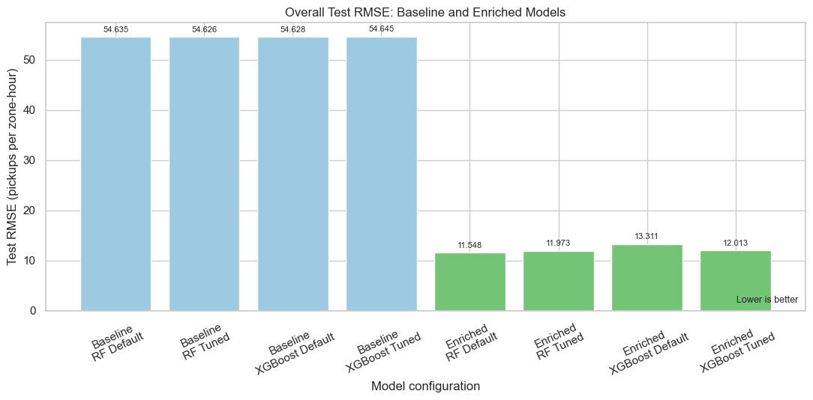
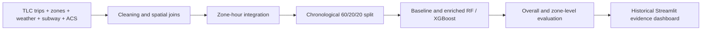

# NYC taxi demand: do contextual features improve zone-level prediction?

Final-year BSc project at Asia Pacific University comparing Random Forest and XGBoost for hourly NYC yellow-taxi pickups in Q1 2025. The question is whether subway proximity and household vehicle access improve predictions, particularly in low-demand outer-borough zones.

**Status:** research notebooks and a historical Streamlit dashboard implementation. Committed preprocessing data passes the local evidence check. Generated model datasets, trained models and evaluation CSVs are absent from this clone, so the analytical dashboard needs pipeline outputs before it can display results. The performance below comes from **saved notebook outputs**, not a new training run.



*Original figure extracted from the saved evaluation notebook. Lower RMSE is better; the test window is 14-31 March 2025. This is a result plot, not a dashboard screenshot.*

## What the project demonstrates

- Integrates TLC trips, taxi-zone geometry, NOAA weather, MTA stations and ACS vehicle-availability estimates into a zone-by-hour dataset.
- Compares five calendar/weather predictors with seven predictors after contextual enrichment. `LocationID` remains evaluation metadata.
- Splits whole hours chronologically into training, validation and test partitions; evaluates eight default/tuned model configurations.
- Implements Gaussian-process Bayesian tuning and reports pooled, per-zone and low-demand-group metrics.
- Provides Streamlit maps, actual-versus-predicted trends and a transparent rule-based planning-evidence view.



## Results and their interpretation

Saved notebook evaluation covers 259 zones x 432 test hours (111,888 observations):

| Configuration | Baseline RMSE | Enriched RMSE |
|---|---:|---:|
| Random Forest, default | 54.6348 | **11.5477** |
| Random Forest, tuned | 54.6256 | 11.9725 |
| XGBoost, default | 54.6276 | 13.3107 |
| XGBoost, tuned | 54.6447 | 12.0126 |

Enriched default Random Forest has recorded MAE **3.8465** and R-squared **0.9569** overall. For the 49 training-defined low-demand outer-borough zones, enriched tuned Random Forest has recorded pooled RMSE **0.3403** and R-squared **0.1052**. The full guide preserves all comparisons, including negative and undefined zone-level R-squared values.

The large enrichment improvement needs care: the static context values also distinguish zones, while the baseline has neither zone identity nor lagged demand. This experiment does **not** isolate a causal accessibility effect. Pooled scores are dominated by Manhattan; sparse-zone R-squared is unstable. Tuning does not consistently improve held-out test performance.

## Inspect and reproduce

Use a fresh Python environment rather than the copied environments already in the repository. Notebook packages are not pinned; dashboard dependency ranges are in [Dashboard/requirements.txt](Dashboard/requirements.txt).

For the lightweight evidence check, from the repository root:

```powershell
python -m pip install pandas
python docs/verify_evidence.py
```

This reads committed CSV/GeoPackage data, checks unique zone-hours and pickup totals, validates notebook JSON, extracts the original saved chart and reports whether dashboard inputs are available. It does not train models or rerun their evaluation. The [verification record](docs/VERIFICATION.md) includes the exact observed result and blocker.

For full reproduction:

1. Install notebook packages and configure local paths as described in the [project guide](docs/PROJECT_GUIDE.md#setup-and-run).
2. Run integration and data-understanding notebooks, then `model_building/01` through `04`. Earlier preprocessing outputs are committed. Fix the documented Census path and timestamp-format mismatches if rebuilding preprocessing from raw inputs.
3. Once evaluation/prediction files exist, install and run the dashboard:

```powershell
python -m pip install -r Dashboard/requirements.txt
python -m streamlit run Dashboard/app.py
```

The app resolves data relative to the project root; `FYP_PROJECT_ROOT` supports an alternate location. Notebook model stages accept `NYC_TAXI_PROCESSED_OUTPUTS`; earlier stages contain machine-specific paths. Full tuning fits many models and is substantially more expensive than the evidence check.

## Scope and further reading

The study uses one quarter of yellow-taxi data, one citywide weather station, centroid-to-station straight-line distances and area-weighted Census estimates. It does not measure taxi supply, unmet demand, waiting time or current conditions. Dashboard flags prompt human investigation; they are not automated dispatch recommendations.

This repository is presented as the author's final-year research implementation. Source data originates from NYC TLC, NOAA, MTA and the US Census Bureau; their attribution and methodological detail remain in the notebooks and [full project guide](docs/PROJECT_GUIDE.md). See also the [dashboard guide](Dashboard/README.md). No repository license file was found; do not assume unrestricted reuse.
